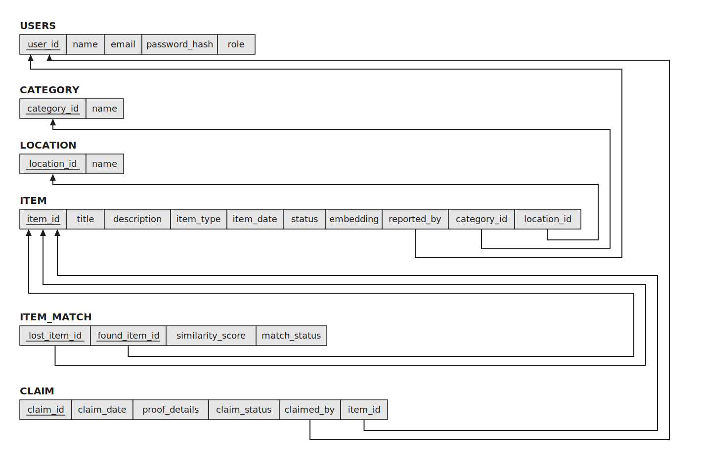
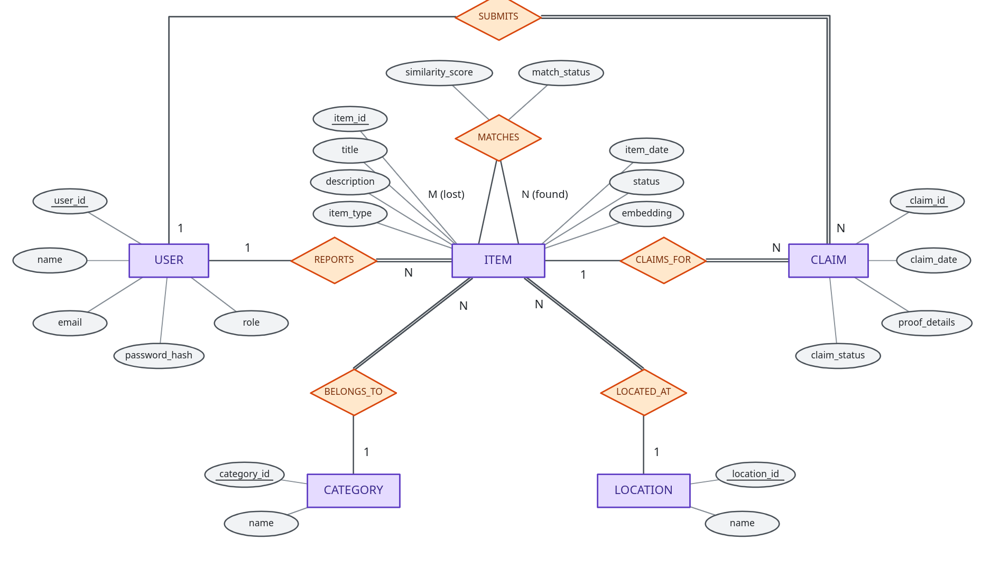

# Smart Campus Lost-and-Found Item Matching System
### DBMS Experiential Learning – Level 3 Project

**Course Instructor:** Dr. Nagasundari S  
**Course:** Database Management Systems (Experiential Learning Level 3)  
**Repository:** [https://github.com/Uttam1916/DBMSMiniProject](https://github.com/Uttam1916/DBMSMiniProject)  
**Database Paradigms:** Relational (PostgreSQL 16) + Vector Database (pgvector HNSW)  
**Web Framework:** Next.js (App Router, TypeScript, Tailwind CSS)  
**Embeddings:** FastEmbed (`sentence-transformers/all-MiniLM-L6-v2`, 384 dimensions)

---

## Team Formation & Responsibilities

| Member | Primary Role | Core Contributions |
| :--- | :--- | :--- |
| **Uttam K R** | Application Architect & Full-Stack Engineer | Next.js Web Interface, PostgreSQL connection pooling, FastEmbed vector integration, API Route Handlers, Role-Based Access Control UI. |
| **Team Partner** | Database Modeler & Integrity Engineer | Relational Schema Design, ER Modeling, DDL/DML execution scripts, PL/pgSQL Triggers (`sync_item_status_after_claim`, `validate_claim_item`), Database Views, and Test Case verification. |

---




---

## 1. Quick Start Guide

### Step 1: Start PostgreSQL with pgvector (Docker)
Ensure your PostgreSQL 16 container with `pgvector` is running:
```bash
docker start campus_postgres
```
*(If setting up a new container)*:
```bash
docker run -d --name campus_postgres -e POSTGRES_PASSWORD=postgres -e POSTGRES_DB=campus_lost_found -p 5432:5432 pgvector/pgvector:pg16
```

### Step 2: Initialize Database Schema (First-Time Only)
Execute the DDL schema, tables, triggers, views, and initial data:
```bash
docker exec -i campus_postgres psql -U postgres -d campus_lost_found < campus_lost_found_setup.sql
```

### Step 3: Run the Next.js Web Application
Install dependencies and launch the development server:
```bash
npm install
npm run dev
```
Open **[http://localhost:3000](http://localhost:3000)** in your browser!

To build for production:
```bash
npm run build
npm run start
```

---

## 2. Web Application Features

The Next.js application provides a clean, institutional interface designed for evaluation and real-world campus usage:

1. **Role Switcher & RBAC**:
   - Easily switch between **Demo Student** (`student@campus.edu`), **Demo Staff** (`staff@campus.edu`), and **Demo Admin** (`admin@campus.edu`) directly in the header.
2. **Overview & Analytics Dashboard**:
   - Live system counts: Total items, Lost vs Found, Vector embeddings status (`384-dim`), Indexed matches, and Claims.
   - Dynamic category distribution bar chart powered by SQL `COUNT FILTER (WHERE ...)`.
   - Real-time monitor of active database triggers and views.
3. **Items Directory**:
   - Searchable and filterable catalog of all reported campus belongings.
   - Filters by Item Type (LOST/FOUND), Category, Campus Location, and Status (OPEN/CLAIMED/RESOLVED/CLOSED).
   - "Report Item" modal that automatically generates 384-dimensional dense vectors and refreshes candidate pairings.
4. **Interactive Semantic Vector Search**:
   - Compare **Vector Cosine Similarity** (pgvector `<=>`) side-by-side with **Relational Keyword Search (`ILIKE`)**.
   - Input any natural language sentence (e.g. *"dark metal water bottle with silver cap"*) to witness semantic match discovery when keyword queries return zero results.
   - Table of persisted matches from the `item_match` table with similarity scores.
5. **Claims & Trigger Demonstration**:
   - Students and Staff can submit ownership claims with identifying proof.
   - Staff/Admin can click **Approve** or **Reject**.
   - **Trigger & Transaction Feedback**: When a claim is approved, the database trigger `sync_item_status_after_claim` automatically transitions the item status from `OPEN` to `CLAIMED` in the same transaction, with real-time feedback displayed on screen.
6. **SQL Console & TA Demos**:
   - Pre-loaded with all 9 TA demonstration queries from the rubric.
   - One-click execution showing execution time in milliseconds, row counts, and data tables.
   - Ad-hoc custom `SELECT` runner for testing queries during evaluation.
7. **ER & Schema Explorer**:
   - Embedded high-resolution diagrams of the ER model and Relational Schema.
   - Complete Data Dictionary detailing keys, constraints, and relationships.
8. **One-Click Database Reset**:
   - Reset button in the header and API (`POST /api/demo/reset`) that restores the database back to clean baseline state in seconds.

---

## 3. Technologies & Architecture

- **PostgreSQL 16**: Relational database engine supporting ACID transactions, table constraints, triggers, views, and stored functions.
- **pgvector Extension**: Native vector type (`VECTOR(384)`), HNSW index (`vector_cosine_ops`), and cosine distance calculation (`<=>`).
- **FastEmbed (`all-MiniLM-L6-v2`)**: Fast, lightweight CPU-based ONNX model that generates normalized 384-dimensional text embeddings from item titles and descriptions.
- **Next.js 14 (App Router)**: Modern React framework with TypeScript, Tailwind CSS, and API Route Handlers.
- **Node-Postgres (`pg`)**: Direct connection pooling connecting Next.js to PostgreSQL.
- **Docker**: Containerized deployment ensuring consistent runtime environment across machines.

---

## 4. Relational Schema & Tables

The schema is normalized across 6 core tables:

| Table | Primary Key | Key Foreign Keys & Constraints | Description |
| :--- | :--- | :--- | :--- |
| **`users`** | `user_id` | `email UNIQUE`, `CHECK (role IN ('STUDENT', 'STAFF', 'ADMIN'))` | Stores campus members authorized to report items or file claims. |
| **`category`** | `category_id` | `name UNIQUE` | Standard item categories (`Electronics`, `Bags`, `Stationery`, `Personal Items`). |
| **`location`** | `location_id` | `name UNIQUE` | Campus zones (`Library`, `Cafeteria`, `Block A`). |
| **`item`** | `item_id` | `reported_by -> users`, `category_id -> category`, `location_id -> location`, `status CHECK ('OPEN', 'CLAIMED', 'RESOLVED', 'CLOSED')`, `item_type CHECK ('LOST', 'FOUND')` | Core repository of reported belongings. Contains `embedding VECTOR(384)` indexed by HNSW. |
| **`item_match`** | `(lost_item_id, found_item_id)` | FKs to `item(item_id) ON DELETE CASCADE`, `CHECK (lost_item_id <> found_item_id)`, `similarity_score CHECK (-1 TO 1)` | Persists candidate lost–found pairings with calculated cosine similarity scores. |
| **`claim`** | `claim_id` | `claimed_by -> users`, `item_id -> item`, `claim_status CHECK ('PENDING', 'APPROVED', 'REJECTED')` | Ownership claims filed against found items, backed by proof details. |

---

## 5. Advanced DBMS Concepts Demonstrated

1. **Relational Constraints & Referential Integrity**:
   - `PRIMARY KEY`, composite primary keys (`item_match`), `FOREIGN KEY ... ON DELETE RESTRICT / CASCADE`.
   - Domain `CHECK` constraints on status, item types, and similarity score ranges.
   - Partial Unique Index: `idx_one_approved_claim_per_item` ensures only one claim per item may ever be approved.
2. **Database Views**:
   - `item_details_view`: Joins items with reporter details, categories, and campus locations.
   - `pending_claims_view`: Pre-joins pending claims with item descriptions and claimant accounts for administrative review.
3. **Stored Function (PL/pgSQL)**:
   - `find_matching_items(lost_item_id, limit)`: Encapsulates vector similarity computation (`1 - (lost.embedding <=> f.embedding)`) restricted to open found items.
4. **Triggers for Business Rules & Auto-Synchronization**:
   - `trg_validate_item_match_types`: Validates that matches only connect `LOST` items to `FOUND` items.
   - `trg_validate_claim_item`: Validates that claims can only be filed against `OPEN` `FOUND` items.
   - `sync_item_status_after_claim`: Fired `AFTER UPDATE OF claim_status ON claim`. When an administrator sets a claim status to `APPROVED`, this trigger automatically transitions the item's status from `OPEN` to `CLAIMED` in the same transaction!
5. **ACID Transaction Control**:
   - Explicit `BEGIN ... COMMIT` blocks verifying trigger execution both within the transaction and after persistence.
6. **Vector Search vs. Keyword Search**:
   - Traditional `ILIKE` fails when descriptions differ (e.g., *"Black stainless-steel bottle"* vs. *"Dark metal water bottle"*). Cosine distance on dense vectors captures semantic intent, yielding a **~0.75 similarity score** and ranking it as the #1 match.
7. **Complex SQL Querying**:
   - Multi-table `JOIN`, conditional aggregation with `FILTER (WHERE ...)`, `GROUP BY`, `HAVING`, subqueries (`IN`), `DISTINCT ON`, `INSERT ... SELECT`, `UPDATE`, and `DELETE ... RETURNING`.

---

## 6. CLI Demonstration Sequence (TA Presentation)

If presenting directly via terminal / CLI, run the scripts in this exact order:

```
Setup SQL  ──▶  Populate Demo Data  ──▶  Show NULL Embeddings  ──▶  Generate Embeddings  ──▶  Show Semantic Matches  ──▶  Demonstrate Triggers  ──▶  Normal SQL Queries
```

### CLI Step 1: Ingest Demo Data
```bash
./.venv/bin/python populate_demo.py
```

### CLI Step 2: Show Items with NULL Embeddings
```bash
docker exec -i campus_postgres psql -U postgres -d campus_lost_found -c "
SELECT item_id, title, item_type, status, embedding, (embedding IS NULL) AS is_embedding_null FROM item ORDER BY item_id;
"
```

### CLI Step 3: Run Vector Embedding Generation
```bash
./.venv/bin/python generate_embeddings.py
```

### CLI Step 4: Show Vector Dimensions
```bash
docker exec -i campus_postgres psql -U postgres -d campus_lost_found -c "
SELECT item_id, title, item_type, status, (embedding IS NOT NULL) AS has_embedding, vector_dims(embedding) AS embedding_dims FROM item ORDER BY item_id;
"
```

### CLI Step 5: Test Semantic Matching Stored Procedure
```bash
docker exec -i campus_postgres psql -U postgres -d campus_lost_found -c "
SELECT found_item_id, title AS found_title, description AS found_description, ROUND(similarity_score::numeric, 4) AS similarity_score
FROM find_matching_items((SELECT item_id FROM item WHERE title = 'Black stainless-steel bottle' AND item_type = 'LOST' LIMIT 1), 5);
"
```

### CLI Step 6: Demonstrate Approval Trigger Inside ACID Transaction
```bash
docker exec -i campus_postgres psql -U postgres -d campus_lost_found -c "
BEGIN;
UPDATE claim SET claim_status = 'APPROVED'
WHERE claim_id = (SELECT cl.claim_id FROM claim cl JOIN item i ON i.item_id = cl.item_id WHERE i.title = 'Dark metal water bottle' AND cl.claim_status = 'PENDING' LIMIT 1);
SELECT i.item_id, i.title, i.status AS item_status, cl.claim_id, cl.claim_status FROM item i JOIN claim cl ON cl.item_id = i.item_id WHERE i.title = 'Dark metal water bottle';
COMMIT;
"
```

### CLI Step 7: Reset Back to Baseline State
```bash
./reset_demo.sh
```

---

## 7. Repository Structure

```
DBMSmini/
├── src/
│   ├── app/
│   │   ├── api/
│   │   │   ├── analytics/route.ts       # Table row counts, aggregates, triggers & views stats
│   │   │   ├── claims/
│   │   │   │   ├── route.ts             # Claims listing and submission with trigger check
│   │   │   │   └── [id]/route.ts        # ACID transaction claim approval + auto-status trigger
│   │   │   ├── demo/reset/route.ts      # One-click baseline demo database reset
│   │   │   ├── items/
│   │   │   │   ├── route.ts             # Filtered items list and insert with auto-vectorization
│   │   │   │   └── [id]/route.ts        # Item details, cascade delete, and status updates
│   │   │   ├── matches/route.ts         # Suggested pairings from item_match & lateral join refresh
│   │   │   ├── meta/route.ts            # Categories, campus locations, and demo users
│   │   │   ├── queries/run/route.ts     # Pre-packaged TA evaluation queries + safe ad-hoc console
│   │   │   └── search/semantic/route.ts # Live vector cosine similarity vs keyword ILIKE search
│   │   ├── globals.css                  # Clean institutional styling & scrollbars
│   │   ├── layout.tsx                   # Metadata and application wrapper
│   │   └── page.tsx                     # Main dashboard page managing tabs and role context
│   ├── components/
│   │   ├── Header.tsx                   # Header with role switcher and demo DB reset button
│   │   ├── Navigation.tsx               # Tab navigation bar with badge indicators
│   │   ├── DashboardTab.tsx             # System health metrics & category aggregation cards
│   │   ├── ItemsTab.tsx                 # Full items directory with filtering and modals
│   │   ├── SemanticSearchTab.tsx        # Side-by-side vector vs keyword search tester
│   │   ├── ClaimsTab.tsx                # Role-based claim approval with ACID trigger feedback
│   │   ├── SqlConsoleTab.tsx            # Interactive SQL query runner with execution timing
│   │   ├── SchemaTab.tsx                # Visual ER and Relational Schema inspector + data dictionary
│   │   ├── ReportItemModal.tsx          # Item submission modal with FastEmbed generation
│   │   ├── ItemDetailModal.tsx          # Deep item inspection with candidate pairings
│   │   └── FileClaimModal.tsx           # Claim filing modal with database trigger validation
│   ├── lib/
│   │   ├── db.ts                        # PostgreSQL connection pool with transaction client helper
│   │   └── embed.ts                     # FastEmbed embedding generator & match refresher
│   └── types/
│       └── index.ts                     # TypeScript interfaces for database records
├── scripts/
│   └── embed_query.py                   # CLI tool generating 384-dim FastEmbed vectors
├── campus_lost_found_setup.sql          # DDL schema, tables, constraints, triggers, views, functions
├── populate_demo.py                     # Demo data ingestion script
├── generate_embeddings.py               # Computes vectors and updates item_match table
├── demo_queries.sql                     # Master demonstration queries arranged in presentation order
├── reset_demo.py / reset_demo.sh        # Baseline demo reset scripts
├── lost_found_ER.png                    # Entity-Relationship diagram
├── lost_found_relational_schema.png     # Relational schema diagram
├── PROJECT_REPORT.md                    # Formal Level 3 Academic Project Report (all 14 rubric sections)
└── README.md                            # Complete documentation and quickstart guide
```
